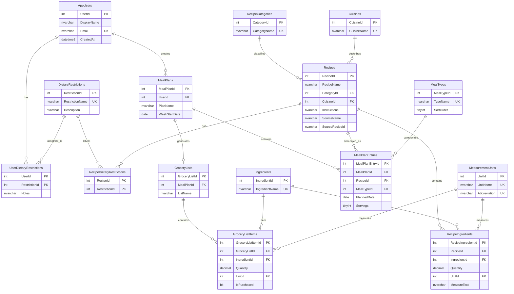

# MealWise Entity Relationship Diagram

The schema contains **15 tables**, exceeding the minimum requirement of eight.

## Relationship summary

- One user can create many meal plans.
- Users and dietary restrictions have a many-to-many relationship through `UserDietaryRestrictions`.
- Recipes belong to an optional category and cuisine.
- Recipes and ingredients have a many-to-many relationship through `RecipeIngredients`. The bridge stores the amount, unit, and original measure text for the ingredient in that recipe.
- Recipes and dietary restrictions have a many-to-many relationship through `RecipeDietaryRestrictions`.
- One meal plan contains many meal-plan entries. Each entry references one recipe, one meal type, and one planned date.
- A meal plan can have one grocery list; a grocery list contains many grocery list items.
- Grocery list items reference the ingredient and optional measurement unit.

## ERD maintenance

When the schema changes, update the SQL table scripts and this diagram in the same pull request. The diagram must match the actual primary and foreign keys in `Sql/01_CreateTables.sql`.
